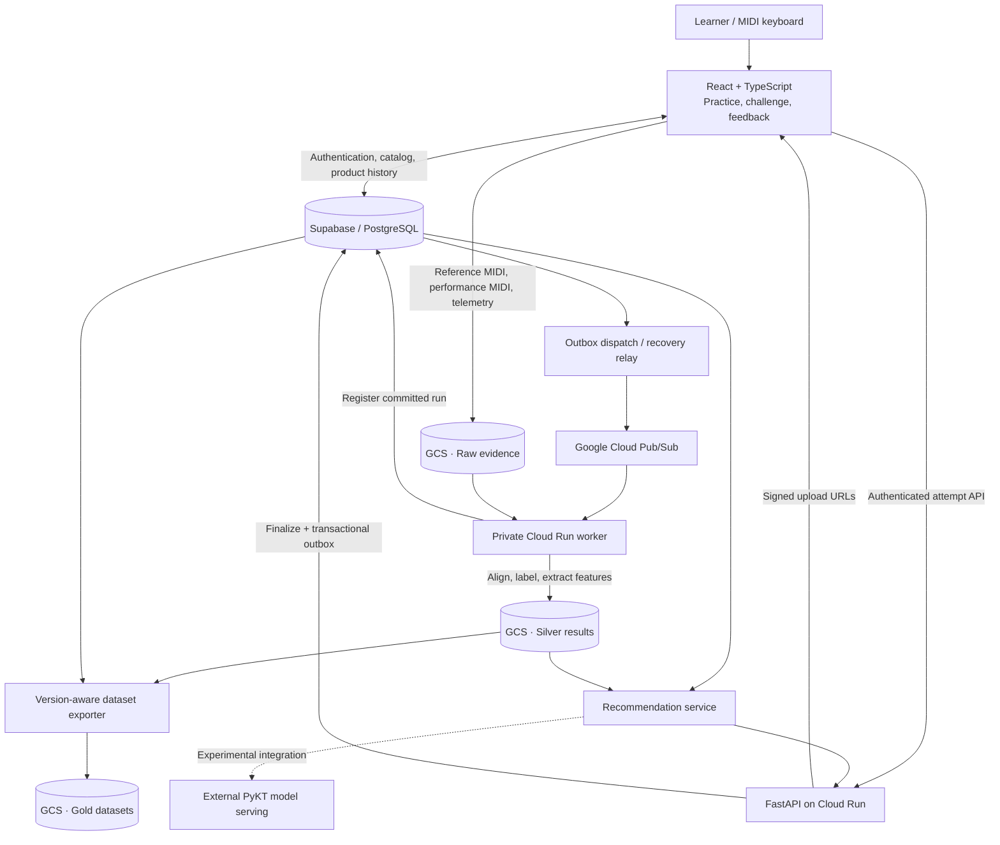
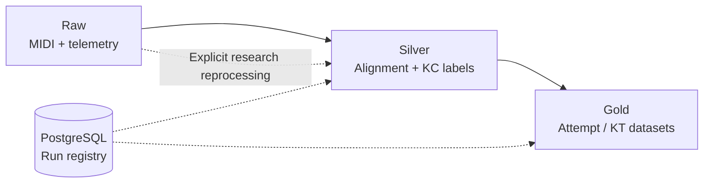

# PianoKT

**From piano practice to structured learning intelligence.**

A browser-based piano learning platform with a reproducible MIDI analysis and knowledge tracing data pipeline.

[Explore PianoKT](https://www.pianokt.com/) · [Architecture](#architecture) · [Data pipeline](#data-pipeline) · [Getting started](#getting-started)


## Overview

PianoKT explores a simple question: **Can everyday musical practice become reliable evidence of how a learner develops skills over time?**

A final practice score can tell a learner how well a performance went, but it says little about which musical patterns were difficult or how those difficulties evolve. PianoKT combines an interactive piano learning experience with a backend that transforms MIDI performances into fine-grained, structured learning interactions.

- **Practice** — play full pieces or shorter segments, with interactive notation, falling notes and MIDI feedback.
- **Challenge** — complete a defined musical task and review performance results and progress.
- **Learning data** — reconstruct note- and onset-level outcomes from recorded evidence and export versioned datasets for knowledge tracing (KT).

Its frontend interaction pannel was builds on the open-source Sightread application, extending its interactive music interface with a learning-data platform, cloud infrastructure and model-serving integration.

## Architecture

PianoKT separates latency-sensitive interaction, asynchronous analysis and reproducible dataset generation. The browser remains responsive while the backend processes recordings independently; product results and research data have distinct contracts.




| Layer                   | Technology                                                     | Responsibility                                                                      |
| ----------------------- | -------------------------------------------------------------- | ----------------------------------------------------------------------------------- |
| Interactive application | React, TypeScript, Vite, Web MIDI API                          | MIDI capture, music visualization, feedback and activity tracking                   |
| Application API         | Python, FastAPI, Supabase Auth                                 | Attempt lifecycle, signed uploads, product results and recommendations              |
| Processing              | Python, Mido, NumPy, Pandas                                    | Score–performance alignment, error classification and feature extraction            |
| Storage and metadata    | Google Cloud Storage, PostgreSQL                               | Immutable artifacts, catalog, run registry and dataset provenance                   |
| Cloud infrastructure    | Cloud Run, Pub/Sub, Cloud Scheduler, Secret Manager, Terraform | Asynchronous processing, compensation, access control and repeatable infrastructure |
| ML integration          | External PyKT serving interface                                | Sequential learner modeling and experimental segment recommendation                 |


## Data pipeline

The V3 architecture uses a lightweight **Raw → Silver → Gold** pipeline rather than introducing a distributed compute framework for the current workload. PostgreSQL serves as the authoritative registry of committed analysis runs; object storage holds the underlying artifacts.


| Stage      | Contents                                                                                   | Purpose                                                                           |
| ---------- | ------------------------------------------------------------------------------------------ | --------------------------------------------------------------------------------- |
| **Raw**    | Reference MIDI snapshot, performance MIDI and transport-aware event telemetry              | Preserve original evidence independently of downstream algorithms.                |
| **Silver** | Versioned alignment results, note correspondences, onset-level labels and musical features | Turn recordings into inspectable learning interactions.                           |
| **Gold**   | Attempt datasets or KT sequences, with manifests and source-run lineage                    | Build reproducible, model-ready datasets from explicitly selected committed runs. |





### Why this design?

- **Evidence is independent of interpretation.** Reference snapshots and performance telemetry are retained so new analysis policies can be evaluated without collecting the same performance again.
- **Asynchronous processing is recoverable.** The browser seals pending uploads in IndexedDB; the API uses signed uploads and a transactional outbox. Pub/Sub delivery is at least once, with worker leases, deterministic run identities and a compensation relay supporting retries.
- **Results have a clear authority boundary.** Immutable analysis artifacts become authoritative through the PostgreSQL run registry. Research reprocessing creates separate runs rather than silently replacing accepted online results.
- **Exports are traceable.** Cutoff timestamps, source environment, quality filters, analysis versions, source run IDs and digests are captured in dataset manifests. Learning sequences retain chronological visit and attempt context.


## From performance to learning interactions


### 1. Transport-aware MIDI alignment

Piano performance is polyphonic: a single musical event can contain several simultaneous notes across both hands. Matching isolated notes or relying on a global search through an entire score can confuse repeated phrases, timing deviations and missing notes.

PianoKT uses the known playback position to constrain a **time-guided, chord-aware monotonic alignment**. Near-simultaneous notes are grouped, candidate chords are matched within a time window, and exact pitch matches are prioritized within each chord. Unmatched notes are represented explicitly as insertions or deletions. The observed playback range also prevents an unplayed ending from being treated as a sequence of mistakes.

The analysis preserves note identity and timing deviations, distinguishes pitch and timing errors, and applies quality checks to inconsistent evidence. Alignment and labeling policies are versioned independently.

### 2. Structured musical features

Each reference onset represents a learning interaction rather than treating an entire piece as one question. Reference-derived features describe the local musical demands independently of the learner's response.


| Feature                 | Musical interpretation    |
| ----------------------- | ------------------------- |
| Black-key usage         | Keyboard geometry         |
| Simultaneous note count | Chord size                |
| Both-hands indicator    | Bimanual coordination     |
| Inter-onset interval    | Temporal demand           |
| Note change count       | Transition complexity     |
| Mean hand movement      | Spatial transition demand |


These six features form a versioned knowledge-component (KC) representation. For example, a two-handed chord may share structural characteristics with a chord in a different piece, creating a basis for investigating skill transfer and reducing interaction sparsity. Whether these features improve modeling is an empirical research question, not an assumed result.

The system retains note-level diagnostics and onset-level correctness; immediate product feedback and backend event accuracy are explicitly distinguished rather than treated as interchangeable measures.

### 3. From knowledge tracing to recommendation

The platform exposes a model-serving boundary instead of coupling its data pipeline to a particular neural network. Aligned histories and reference-only candidate features can be consumed by an external PyKT service.

The experimental integration estimates onset-level success probabilities, shortlists suitable segments and uses simulated practice trajectories to estimate expected improvement on a fixed target distribution. Recommendations operate on segments, while practice can also use full songs. Model compatibility and history revisions are checked at the integration boundary.

**Current status:** the default recommendation endpoint uses a clearly identified rule-based demo. Learned recommendations are development-only and require a compatible external model service; their educational effectiveness has not yet been established.

## Getting started


### Frontend

Use a Web MIDI-compatible browser (for example, desktop Chrome) and a MIDI keyboard for physical-keyboard interaction. For connected features, configure an isolated development Supabase project and the local API URL.

```bash
git clone https://github.com/chilltse/pianokt.git
cd pianokt
cp .env.local.example .env.local
npm ci
npm run dev
```


### Backend

Python 3.13 is required. From the repository root:

```bash
python3.13 -m venv .venv
source .venv/bin/activate
pip install -r backend/requirements.lock
pip install --no-deps -e backend
```

For the connected stack, configure the variables documented in `[backend/.env.example](backend/.env.example)`, including `DATABASE_URL`, `DATA_ROOT`, `SUPABASE_URL` and `PIANOKT_ENV`. Apply the relevant Supabase migrations to an isolated development database. Use the appropriate GCS and Pub/Sub credentials for cloud-backed processing.

Run the API and worker in separate terminals with the configured environment:

```bash
make api
make worker
```

`make api` listens on port 8080; set `VITE_PIANOKT_API_URL` accordingly. The worker listens locally on port 8081. Cloud deployments wire dispatch to the worker through Pub/Sub; simply starting both local processes does not configure message delivery.

### Explore the analysis independently

The alignment and reference feature extraction CLI can be used without deploying the full application:

```bash
pianokt-data align \
  --reference reference.mid \
  --performance performance.mid \
  --output data/debug/result.json

pianokt-data extract-reference reference.mid \
  --output data/debug/features.json
```

Standalone MIDI-only alignment lacks browser transport telemetry and may fail its quality checks when calibration evidence is insufficient.

## Repository guide


| Path                                                                       | Purpose                                                               |
| -------------------------------------------------------------------------- | --------------------------------------------------------------------- |
| `[src/](src/)`                                                             | Interactive application and product flows                             |
| `[backend/pianokt_backend/](backend/pianokt_backend/)`                     | API, worker, storage and application services                         |
| `[backend/pianokt_backend/alignment/](backend/pianokt_backend/alignment/)` | MIDI matching, error labels and reference feature extraction          |
| `[backend/pianokt_backend/pipeline/](backend/pianokt_backend/pipeline/)`   | Dataset selection, export and lineage                                 |
| `[supabase/migrations/](supabase/migrations/)`                             | Database schema and transactional contracts                           |
| `[infra/gcp/](infra/gcp/)`                                                 | Terraform-managed Google Cloud infrastructure                         |
| `[backend/tests/](backend/tests/)`                                         | Analysis, data contract, concurrency and integration regression tests |


### Validation

```bash
npm run check-types
npm run test:uploads
npm run test:protocol
npm run test:catalog
npm run build

pip install 'pytest>=8,<10'
make backend-test
```

Some backend integration and experimental tests require additional dependencies and a dedicated PostgreSQL/PGlite test setup. See [the validation workflow](.github/workflows/validate.yml) for its configured test environment. Never run database integration tests against production.

The repository includes infrastructure definitions and validation coverage; this does not imply that every feature in the current branch is deployed to the public application.

## Acknowledgments and license

A part of PianoKT's frontend was extended from the open-source **Sightread** project. 

The repository is licensed under the [GNU General Public License v3.0](LICENSE). Music assets may have separate source and licensing terms. Learner recordings and research datasets are not covered by the software license or implied to be publicly available.