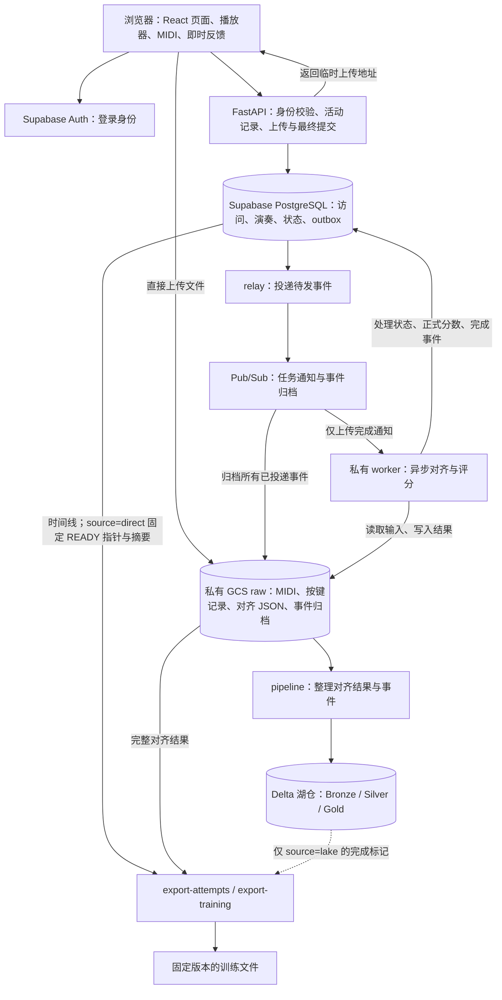

# PianoKT 当前工程架构：从网页练习到训练数据

更新日期：2026-11-03。按当前工作区代码整理，数据库结构以 migration 015 为止。这里描述代码已经实现的行为；实际云端是否已部署相同版本，需要另外核对。

## 1. 先用一段话理解整个项目

PianoKT 首先是一个在浏览器里运行的钢琴练习网站：浏览器负责读乐谱、接收琴键、播放声音、显示谱面和即时反馈。学生完成一次 Challenge 后，网站保存这次演奏，后端把“应该弹什么”和“实际弹了什么”进行对齐，产生逐音符结果。之后，可以按需直接从数据库已提交结果与 GCS 导出训练数据，无需先入湖。旧湖仓路径仍保留作为分析和并行验收基线，默认导出路径暂未切换。推荐入口已经接通，目前采用演示规则。

可以把它理解成六个分工明确的部分：

1. **网页练习端**：让学生看谱、弹奏、暂停、继续和结束。
2. **在线数据库**：记录谁访问了网站、何时练习、录音是否保存、处理到哪一步。
3. **文件存储**：保存 MIDI、按键时间记录和完整对齐结果。
4. **对齐后台**：判断每个目标音是正确、漏音、错音还是节奏有误。
5. **可选的旧湖仓路径**：把原始结果整理成便于查询的历史明细与统计表。
6. **数据集导出**：选择可信结果，固定版本，生成训练文件。

## 2. 全局关系图



这张图里有两条时间尺度不同的链路：学生弹奏时的反馈在浏览器即时发生；服务端对齐、入湖和导出在之后执行。一次录音上传成功，不代表对齐已经完成；对齐完成，也不代表已经进入训练数据集。

直接导出通过显式参数 `--source direct` 启用。省略参数仍是 `--source lake`，直到完成真实环境并行验收。两条路径使用同一排序和转换逻辑。direct 只支持当前 READY run；旧版本或缺少 migration 015 提交摘要的历史结果不会猜测补齐。详见 [实际变更与验收](DATA_PIPELINE_SIMPLIFICATION_IMPLEMENTATION_ZH.md)。

## 3. 浏览器内有哪些模块

前端是 React + TypeScript，页面由 React Router 组织，播放器状态主要由 Jotai 管理。

- `src/pages/`：首页、曲库、练习、Challenge、录音列表、账号和训练页面。
- `src/features/data/`：读取内置曲目、本地文件或 base64 MIDI，获得统一的 Song 数据。
- `src/features/parsers/`：乐谱文件与 Song 结构之间的转换工具；当前 `useSong` 入口加载 MIDI。
- `src/features/player/`：歌曲时间、倒数、播放、暂停、速度、手部、等待模式和即时分数。
- `src/features/midi/`：接收 MIDI 键盘/电脑键盘输入，录制实际演奏，保存原始时间信息。
- `src/features/SongVisualization/`、`synth/`：谱面/落键可视化和声音播放。
- `src/features/auth/`：登录状态、白名单检查、资料同步及上传恢复启动。
- `src/features/activity/`：整个网页访问与每次演奏的时间线。
- `src/features/challenge-history/`：录音上传、恢复队列、历史查询和推荐调用。

Challenge 页面负责把这些模块接起来。它的生命周期记录在 `useChallengeAttempt.ts`，参考乐谱快照在 `referenceSnapshot.ts`，完整录音的恢复在 `upload-queue.ts`。

普通 Play、Freeplay 和训练页面仍使用前端练习能力。当前完整的“访问 → 演奏 → 上传 → 对齐 → attempt 数据集”采集接在 **Challenge**，不能把其他页面自动算作同样完整的数据来源。

## 4. visit、attempt、alignment run 分别是什么

活动记录绑定已认证用户；未登录或未配置活动 API 时，不会自动形成完整的学生研究时间线。

**visit 是一次网页访问窗口。** 学生在一个标签页里浏览主页、看排名、换曲和练习，仍属于同一个 visit。刷新延续 visit；重新打开、另开标签页或离开其他网页后返回，建立新 visit。切后台本身不结束 visit。

**attempt 是一次实际演奏。** 它从倒数结束、乐谱真正开始播放时开始。暂停和继续属于同一个 attempt；完成、主动退出或中断结束这次演奏。一个 visit 可以有多个 attempt。

**alignment run 是对某次演奏的一次算法处理版本。** 同一 attempt 用不同配置或算法处理，可以有不同 run。输入摘要、算法配置、matcher 版本和时间上下文共同决定 run ID。

例子：同一个学生打开网站，看了一次排名，弹曲 A，暂停后继续，然后改练曲 B。

```text
visit
├─ 浏览主页、排名
├─ attempt 1：曲 A，开始 → 暂停 → 继续 → 退出
└─ attempt 2：曲 B，开始 → 完成

attempt 1
└─ alignment run：这次曲 A 的某一版对齐结果
```

数据库中的旧 `session_id` 仍表示单次播放周期。新 Challenge 客户端把它与 attempt ID 对齐，**不要拿 visit ID 填入这个字段**。

## 5. 学生弹完一次，系统实际做什么

1. **开始时记时间线。** `/activity` 保存 visit、attempt 及开始/暂停/继续等事件。这时即使最后没上传成功，也可能留下演奏发生过的记录。
2. **结束时封存录音。** 浏览器得到演奏 MIDI、参考 MIDI、按键记录和终止事件。完整包先写入 IndexedDB。
3. **申请上传。** `/attempts` 创建 CREATED 任务，返回私有 GCS 临时签名地址。
4. **浏览器直传文件。** 正常新录音包含 `performance.mid`、`reference.mid`、`performance-events.json`。
5. **请求最终提交。** `/finalize` 检查文件摘要、大小、事件顺序和时间线身份；在同一个数据库事务里写入录音列表、练习汇总、UPLOADED 状态及 outbox。
6. **后台收到通知。** relay 把 outbox 发到 Pub/Sub，私有 worker 被上传完成事件触发。
7. **对齐并保存结果。** worker 写入版本化 JSON，再把 READY、正式评分与完成 outbox 一起提交。
8. **随后整理和导出。** pipeline 写入湖仓；导出程序按时间、质量和版本规则挑选数据。

上传中断时，同账号下次登录、网络恢复或定时恢复会重试已封存的录音。浏览器被强杀前尚未封存的 MIDI 不保证可恢复。

## 6. 数据各自放在哪里

**Supabase PostgreSQL 存“身份、时间线与业务状态”。**

- `student_visits`：访问开始、最后在线、结束与结束是否推断。
- `student_attempts`：演奏的真实开始/结束、所属 visit、歌曲与访问内顺序。
- `student_attempt_events`：暂停、继续、退出等节点及歌曲位置。
- `piano_attempts`：上传文件指针、摘要、任务状态、对齐结果指针、租约。
- `challenge_recordings`、`user_play_logs`：录音列表与一次播放的汇总。
- `piano_outbox`：必须可靠投递的业务事件。
- learner key、推荐目录、偏好和推荐反馈等辅助表。

**GCS raw 存“原始证据和完整结果”。** 两份 MIDI、按键/transport 记录、matching 中间数据、完整对齐 JSON、Pub/Sub 事件归档都在这里。

**Delta lake 存“便于分析的整理结果”。** Bronze 保留来源，Silver 整理明细，Gold 保存质量通过的逐音符、逐 onset 和逐 run 统计。

**导出目录存“一份固定训练快照”。** 主数据、访问元数据、事件时间线、关联映射及 manifest 成套保存。

这些数据有不同用途。网页查录音列表走在线数据库；训练导出会结合数据库上下文、raw 结果和湖仓完成标记。

## 7. 当前对齐器怎样判断弹得对不对

当前入口是 `alignment/service.py:align()`，matcher 为 `time-guided-chord-monotonic-v3`。

它首先把参考与演奏放到同一歌曲时间坐标：新录音优先使用按键记录中的 playerSongTime，按参考片段起点转换。然后按时间聚合和弦，在有限时间窗口内做保持先后顺序的匹配，再生成逐音符标签和逐 onset 数据。

提前退出只评估实际观察到的曲段，后面的未练习曲谱不会全部被算成漏音。暂停的墙上时间也不会直接算成音乐节奏偏差。

逐目标音错误码为：0 正确、1 漏音、2 错音、3 节奏错误、4 错音且节奏错误。多弹音记录在 `extra_notes`。

当前生产路径没有调用 Parangonar；旧依赖和兼容工具仍可能保留在仓库。完整结果的 `schema_version=3`、事件结构 v1.1、attempt 数据集外层 v1.2，是三个不同层次的版本。

## 8. 三种“分数/结果”不要混淆

- **浏览器即时分数**：服务于练习交互，随演奏更新。
- **后端正式对齐分数**：worker 根据参考与实际演奏计算，使用 `score_source='aligned'` 标识；排行榜正确率只采用这类成绩。
- **训练标签**：导出程序还要求上下文完整、质量通过、非 waiting、截止时间与版本选择符合要求。

READY 表示 worker 已保存结果；质量不通过的结果也可以 READY。应同时看 `alignment_quality_valid`。有结果但质量被拒绝时，仍保存证据供排查，不产生可信训练标签。

## 9. 最终的数据集长什么样

`export-attempts` 生成“一次演奏一行”的 `attempts.jsonl`，接近根目录的 `pianokt_attempt_example_v1_1.json`。文件名保留 v1_1，当前外层顺序字段采用 v1.2 约定。

每行包含学生伪名、歌曲/练习身份、统计、`days_since_signup`、`visit_index`、`attempt_index` 和列式 `events_data`。

- `visit_index`：这个学生的第几次访问。
- `attempt_index`：这个学生的第几次演奏，跨 visit 排序。
- `days_since_signup`：真实开始时间减去注册时间，单位天，可带小数。

开始/结束时间、内部 ID、暂停/退出节点另放在元数据文件。顺序先按 UTC 时间排，再用稳定字段打破并列；先编号，再筛除质量不合格记录，因此允许缺号。补传旧历史可能改变新快照编号，已经发布的数据集不会被改写。

`export-training` 是另一个序列化入口，输出逐 onset 的扁平样本。两个 exporter 都只导出数据，目前没有训练 AKT 或其他知识追踪模型的作业。

## 10. 原子性怎样保证

数据库里的一个业务动作使用同一事务：相关表与 outbox 一起成功或回滚。

跨数据库、GCS、Pub/Sub 和多张 Delta 表时，使用“不可变输入 + 幂等 ID + 最后提交标记”。它们不会在物理上同一瞬间提交。正式读者遵守提交标记，就不会把写到一半的数据当作已完成数据。

- 上传最终提交看数据库状态。
- alignment 入湖看 `ops/completed_runs`。
- Spark 事件入湖看 `ops/practice_event_commits`。
- 数据集看最后写入的 `manifest.json`，并检查文件摘要。

相同 ID 相同内容可重试；相同 ID 不同内容报错。worker 还有 lease_token 校验，防止过期任务覆盖新任务。

## 11. 现在页面能看到什么

录音页目前展示录音列表、MIDI 下载和演示推荐入口。API 已提供 attempt 状态与完整结果下载，页面尚未接入完整对齐状态/结果查看器。

本地 Alignment Lab 可以显示实际对齐卷帘与 JSON；它是开发调试分支，不能当作正式训练数据集导出。

推荐器目前为 `DemoRecommender`：读取最近有效结果、偏好与候选目录，按难度/偏好规则返回建议。`is_demo=true`，没有训练好的能力预测或学习收益预测。

## 12. 接下来该看哪份文档

- 想逐步理解一份演奏：[按一次练习读代码](PIANOKT_TEACHING_GUIDE_ZH.md)。
- 想查模块、数据库、文件、接口与状态：[系统实现参考](PIANOKT_SYSTEM_REFERENCE_ZH.md)。
- 想本地运行：[本地开发](LOCAL_DEVELOPMENT_ZH.md)；想部署：[运行与部署](DEPLOYMENT_AND_ROADMAP_ZH.md)。
- 想查身份和权限：[登录、权限与录音](AUTH_AND_RECORDINGS.md)。
- 想生成训练数据：[访问与数据集导出](VISITS_AND_ATTEMPT_DATASET_ZH.md)。
- 想看最近重构、事务限制与迁移：[重构和数据完整性记录](REFACTOR_AND_DATA_INTEGRITY_ZH.md)。

本页负责讲清整体；技术细节在对应专项文档。代码更改时，应同步维护实际影响的说明，不能只给过时正文加一个“以新代码为准”的提示。
