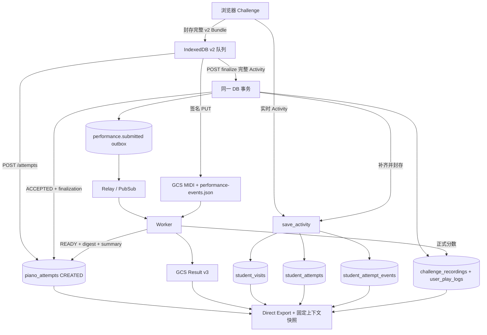

# PianoKT 数据架构精简：v2 实施结果与决策

2026-11-05 最新架构：异步 finalize v3 + migration 017，详见 [异步接收与部署](ASYNC_FINALIZATION_ZH.md)。此前性能优化见 [计时说明](UPLOAD_PERFORMANCE_ZH.md)。

更新：2026-11-04。本文已从讨论方案更新为当前代码实践，对应 migration `016_challenge_event_authority.sql`。**代码已实现，不表示目标 Supabase/GCP 已部署。** 完整字段见 [数据字典](DATA_CONTRACT_V2_ZH.md)，上线步骤见 [部署手册](DEPLOYMENT_AND_ROADMAP_ZH.md)。

## 1. 已落实的取舍

- Challenge 生命周期事件唯一权威表为 `student_attempt_events`。`/activity` 和 finalize 都调用 `save_activity()`，不再将同一事件写进 `play_events_raw`。
- `/attempts` 只登记文件身份与 CREATED 任务；不再接收 `activity` 或 `session_id`。新协议必须明确 `schema_version: 2`。
- finalize 接收 `{schema_version: 3, activity: {owner_id, visit, attempt, events}}`。它在同一事务补齐上下文/事件、核验完整序列、封存、更新 ACCEPTED、更新录音列表、写 outbox，返回 202；文件校验和演奏汇总延后到 Worker。
- 事件只有一套字段：`event_sequence`、`occurred_at`、`song_time_sec`、`elapsed_playing_sec` 等。累计演奏时间不再从任意 metadata 回退推断。
- `student_attempts` 与 `piano_attempts` 分开保留：开始过演奏不等于已有可上传录音。
- `challenge_recordings` 与 `user_play_logs` 保留为可重建投影。新增 `rebuild-projections --attempt-id UUID`，从 v2 封存输入和当前处理结果重建。
- 原始 MIDI、遥测和对齐 Result 继续放 GCS；Result v3 暂保留完整遥测数组，避免牵动历史格式身份和 Lake 消费者。
- IndexedDB、GCS create-only、摘要核验、Worker 租约、outbox/relay/PubSub 均保留。
- 默认导出切换为 Direct，默认环境 `production`。Lake 显式 `--source lake`，Terraform 的 `lake_pipeline_paused` 默认 true，独立于 relay。

## 2. 核心数据流

## 3. 原子性、冲突与中断

Finalize 与实时 Activity 都先获取同一个 attempt advisory transaction lock。已有事件按 ID、attempt、sequence、类型、时间、累计时间和 metadata 精确比较；float8 在 PostgreSQL 内比较，真实一个 ULP 的变化仍冲突。

Finalize 要求从 0 连续编号、唯一事件 ID、start→pause/resume→finished/exited 的合法状态机、歌曲时间/累计时间/时间戳不回退。补写后要求表中事件总数等于完整封存序列，再设置 `sealed_at` 和 `sealed_event_count`。其后重复相同事件可接受；新事件和修改事件拒绝。任何一步失败，整个事务回滚。

`interrupted` 是未完成演奏的真实记录，可以没有录音。若它已经写入，另一个不包含它的 finished/exited 包不能覆盖它或遗漏它；finalize 返回 409。冲突保留证据，不能用换 event ID、删行、容差或覆盖来掩盖。

## 4. 升级与历史边界

本轮按项目允许升级客户端契约实施，不维护 v1 上传兼容层。旧 `cycle` 请求和缺少 v2 标记的 `/attempts` 请求会返回 422。

浏览器改用 `pianokt-upload-recovery-v2`、`pianokt-visit-v2:*`、`pianokt-activity-v2:*`。旧队列不会自动转换或重放，也不会被程序删除。升级后刷新并新录一段；若未来需要救回旧包，应做独立审计转换工具。

`play_events_raw` 作为只读历史留存；迁移移除其 outbox trigger，撤销旧 log/aggregate/save recording RPC 的客户端执行权限。旧前端 `legacy-events.ts` 和无调用导出已删除。保留旧 Supabase Storage 下载兼容。没有 DROP 旧事实表，也没有把历史 unknown 来源猜成 production。

## 5. 环境与评分语义

环境由 API 的 `PIANOKT_ENV` 决定，默认 `development`；只允许 development/test/staging/production。Visit、Attempt、上传任务和录音投影都记录 `source_environment`，身份重放不得跨环境改写。历史行默认 unknown。

正式导出默认 production；过滤在分配 visit_index/attempt_index 之前发生，包含 Visit/Attempt/Event/Result。Manifest 保存来源环境。生产榜单也仅统计 production 录音；本地 Alignment Lab 不再启动 Activity tracker。Terraform 不再默认放行 localhost CORS，本地启动脚本强制 development。

这属于逻辑隔离。独立开发 Supabase 项目、GCS Bucket 和部署凭据仍是推荐部署方式。若本地直接使用生产 API，其数据会由生产 API 标记为 production，不能把浏览器地址当作可信来源。

- `completion_reason=finished/exited`：播放终止行为。
- `client_success=true/false/null`：客户端挑战判定。
- `exit_status`：为既有研究格式保留的客户端结果映射，缺失判定为 unknown。
- `accuracy_pct` + `score_source`：Worker 对齐评分与质量状态。
- `READY`：处理完成；并不必然通过质量门，仍需 `alignment_quality_valid`，训练还排除 waiting。

Worker 不把客户端成功事实改成自己的评分；投影重建保持这一分工。

## 6. 导出与后续事项

当前的复现单位是发布后的不可变数据集及其上下文快照、Manifest 和摘要。相同 Cutoff 之后重新查库，可能获得更新的访问状态；不能承诺历史时点数据库回放。Direct 只接受当前 READY 指针，未来需要历史 run 回放时再增加提交历史。

Result 引用化、删除旧表、撤销全部 Lake 资源不在本次直接执行：这些仍有读者/对象身份/历史用途依赖。已将 Lake 调度默认独立暂停，并让主路径不依赖 Delta/Spark。需要时显式启用；Result v3 字段没有删除。

验收：正常完成/退出、多次暂停、先到/后到/乱序 Activity、无 Activity 的 finalize 补写、真实篡改、interrupted 冲突、同包重试、GCS digest 错误、投影重建、环境过滤、Direct/Lake fixture 一致性。真实 PostgreSQL 并发测试已接入 CI 专用测试数据库，不能指向生产 DATABASE_URL。

017 补充：user_play_logs 只在 validated_at 提交时建立；榜单只纳入验证通过录音；本地恢复包保留到 validated_at。具体状态、错误和部署约束以异步接收文档为准。
